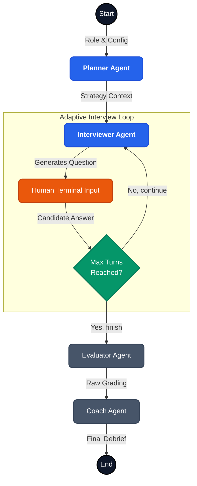

# AI Mock Interview Coach

Here is my submission for the AI Prototype Engineer internship assignment. 

The goal was to build a multi-agent system that runs a realistic mock interview and delivers actionable coaching feedback. I built this terminal-based Mock Interview Coach using LangGraph to tackle that exact problem. 

Instead of a static list of canned questions, I wanted the system to mimic how real interviews escalate — where the interviewer digs into specific answers, probes weak spots, and calibrates difficulty on the fly.

## What it does

You feed it your target role, experience level, and focus area. The system orchestrates four specific agents to run the session:

- **Planner Agent:** Scrapes recent interview trends from Reddit and technical blogs to set a realistic strategy before the interview starts.
- **Interviewer Agent:** Drives the conversation. It maintains context, listens to your answers, and pushes back for deeper technical details or STAR-method examples.
- **Evaluator Agent:** Grades your answers silently in the background after the interview concludes.
- **Coach Agent:** Translates the raw evaluation into a supportive, actionable debrief report.

(Side note: The evaluation and coaching happen offline at the end. I avoided real-time feedback so the experience feels like a fluid conversation rather than a rigid exam.)

## The Architecture

The orchestration runs on a LangGraph state machine. 



*(Another tradeoff: The edge condition controlling the loop — `CheckTurns` — is a deterministic Python function, not an LLM decision. LLM routing in state machines gets messy fast. A hard turn cap keeps the UX predictable.)*

## Example Transcripts

I ran the system against a few different candidate profiles to see how it adapts. You can read the raw Markdown outputs here:

1. **[The Weak Candidate (Intern Backend Engineer)](transcripts/2026-08-06_22-32_Backend_Engineer.md)**
   A junior candidate who struggles with technical depth. The Interviewer probes for basics, and the Coach provides foundational learning resources.
2. **[The Strong Candidate (Senior Backend Engineer)](transcripts/2026-08-06_22-45_Backend_Engineer.md)**
   A senior engineer who nails the architecture questions. The Interviewer escalates difficulty to find their ceiling.
3. **[The Edge Case (Senior Data Scientist - Mixed)](transcripts/2026-08-06_23-28_Data_Scientist.md)**
   A candidate with great behavioral answers but massive operational red flags. The Coach report praises the STAR method while critiquing the lack of MLOps maturity.

## Setup & Run

1. Clone the repository:
   ```bash
   git clone https://github.com/cubaseuser123/Ai_Mock_Interview_Coach.git
   cd Ai_Mock_Interview_Coach
   ```
2. Install dependencies:
   ```bash
   pip install -r requirements.txt
   ```
3. Set your API key in a `.env` file:
   ```env
   GEMINI_API_KEY=your_api_key_here
   ```
4. Run the Coach:
   ```bash
   python main.py
   ```

Happy to tweak the prompts or the LangGraph structure if anyone has ideas. Let me know what you think!
