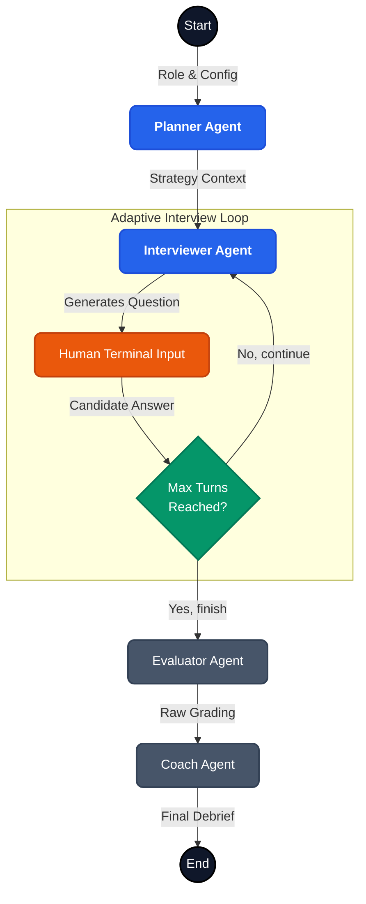

# AI Mock Interview Coach

This is my submission for the AI Prototype Engineer internship assignment. 

The prompt asked for a multi-agent system that runs a realistic mock interview and gives useful feedback. Most mock interview bots just read from a static list of questions. I wanted to build something that actually escalates — an interviewer that digs into your answers, probes weak spots, and calibrates difficulty mid-chat.

To do this, I built a terminal-based CLI using LangGraph.

## What it does

You provide a target role, experience level, and focus area. Four agents run the session:

- **Planner Agent:** Scrapes Reddit and tech blogs via Jina Reader to set the interview strategy.
- **Interviewer Agent:** Drives the chat. It tracks context and pushes back for deeper technical details or STAR examples.
- **Evaluator Agent:** Grades the transcript in the background after you finish.
- **Coach Agent:** Turns that raw grading into a debrief report.

(Side note: I moved evaluation and coaching to the end. Giving real-time feedback after every answer breaks the flow of a real interview.)

## The Architecture

The state machine runs on LangGraph.



*(Another tradeoff: The edge condition controlling the loop — `CheckTurns` — is a deterministic Python function, not an LLM decision. LLM routing in state machines gets messy fast. A hard turn cap keeps the UX predictable.)*

## Example Transcripts

I ran the system against three candidate profiles. You can read the raw Markdown outputs here:

1. **[The Weak Candidate (Intern Backend Engineer)](transcripts/2026-08-06_22-32_Backend_Engineer.md)**
   A junior candidate who struggles with technical depth. The Interviewer probes for basics; the Coach provides foundational resources.
2. **[The Strong Candidate (Senior Backend Engineer)](transcripts/2026-08-06_22-45_Backend_Engineer.md)**
   A senior engineer who nails the architecture questions. The Interviewer escalates difficulty to find their ceiling.
3. **[The Edge Case (Senior Data Scientist - Mixed)](transcripts/2026-08-06_23-28_Data_Scientist.md)**
   A candidate with solid behavioral answers but major operational red flags. The Coach report praises the STAR method while calling out the lack of MLOps maturity.

## Setup & Run

1. Clone the repository:
   ```bash
   git clone https://github.com/cubaseuser123/Ai_Mock_Interview_Coach.git
   cd Ai_Mock_Interview_Coach
   ```
2. Install dependencies:
   ```bash
   pip install -r requirements.txt
   ```
3. Set your API key in a `.env` file:
   ```env
   GEMINI_API_KEY=your_api_key_here
   ```
4. Run the Coach:
   ```bash
   python main.py
   ```

That's the core loop. The code is modular enough to swap in different prompts or state logic if needed.
